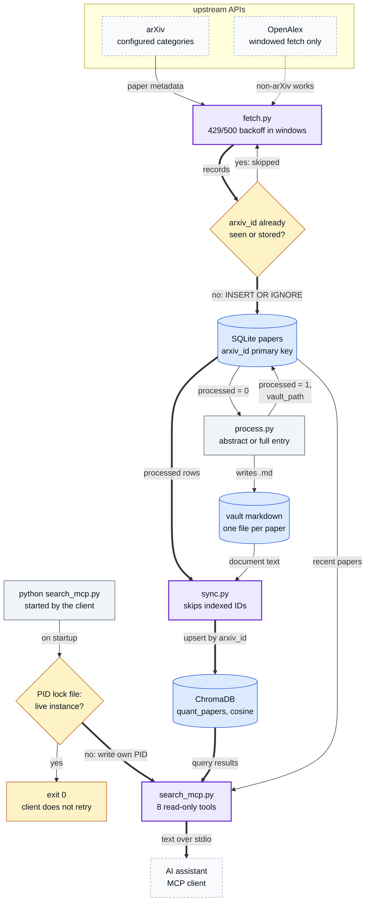
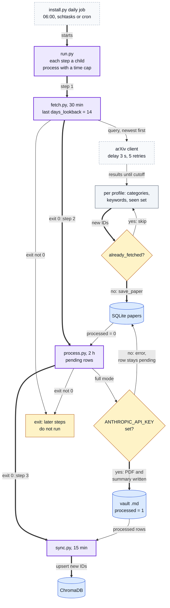

# Quant Research Vault

[](https://github.com/oscar-chw/quant-research-vault/actions/workflows/quality.yml)

A local Python pipeline that fetches academic-paper metadata from arXiv (optionally OpenAlex) into SQLite, indexes processed records in ChromaDB, and exposes read-only paper search through MCP. A separate hash-verified interface serves the original method notes in `notes/manifest.json`. Its optional retrieval report identifies exact matching source excerpts, unsupported query terms, omitted results and integrity errors; it also runs as a standard-library-only CLI.
At a 2026-07-30 audit its local, unpublished database held 18,492 paper rows ([what that count rests on](docs/corpus-audit.md)).
Deduplication, fetch windows, rate-limit backoff, search compatibility and shared-note integrity are covered by offline tests.

From upstream metadata to an AI assistant's search: deduplicated into SQLite, written to the vault, indexed in
ChromaDB, and served read-only over MCP by a single server instance.



Where in the code: `fetch.py` (`fetch_recent`, `fetch_window`, `_iter_with_retry`, `fetch_openalex_window`,
`already_fetched`, `save_paper`), `process.py` (`get_pending`, `mark_processed`), `sync.py` (`already_indexed`,
`index_paper`), `search_mcp.py` (`_acquire_lock`, `build_server`), `config.yaml`.

## Why this exists

Reading the quant-finance literature from an AI assistant needs a corpus the assistant can search locally: papers
fetched once, deduplicated, kept on disk, and served read-only by a single server instance.

## Approach

- `fetch.py` queries configured arXiv categories and optional OpenAlex and stores records in SQLite with `INSERT OR IGNORE` keyed by paper ID; the windowed history fetch backs off after HTTP 429 and 500 responses ([waits](docs/architecture.md#what-each-stage-does)).
- `process.py` writes one vault markdown entry per paper, abstract-only by default; full analysis is optional (Anthropic API key, or Claude Code with [docs/analysis-skill.md](docs/analysis-skill.md)).
- `sync.py` indexes processed entries in ChromaDB and skips IDs already present.
- `search_mcp.py` serves paper tools and a separate `search_shared_notes` tool over stdio. Shared notes are read directly from the manifest and source files; see [the shared-note contract](docs/shared-notes.md).
- `search_shared_notes_report` adds inspectable literal retrieval over the same notes. It removes common English function words, reports matched/missing terms and quotes bounded exact note lines with source and manifest digests. It is a separate opt-in interface; existing consumer envelopes are unchanged. See [the query-to-source walkthrough](docs/retrieval-report.md).
- `verify_shared_notes_report` checks a saved response against its recorded corpus and current v1 policy. It rejects altered quotes/citations, false coverage or status, source changes and ambiguous JSON. Verification establishes source/policy consistency; it does not authenticate an author or certify semantic relevance. See [saved-report verification](docs/saved-report-verification.md).
- Design decision: abstract-only indexing is decoupled from optional full-text, model-assisted enrichment, so the corpus is searchable before the slower enrichment stage; the trade-off is that early retrieval quality is limited to metadata and abstracts.

The daily job: `install.py` schedules `run.py` at 06:00, which runs three child processes in order and stops at the
first that fails. The daily fetch is the last 14 days through the arXiv client's own retries; the 429/500 backoff
above applies to the windowed history fetch (`run.py --all-history`).



Where in the code: `install.py` (`create_scheduled_task`), `run.py` (`run_step`, `_STEP_TIMEOUT`, `main`),
`fetch.py` (`fetch_recent`, `already_fetched`, `save_paper`), `process.py` (`_process_one`, `summarize`),
`sync.py` (`main`), `config.yaml` (`days_lookback`).

## Results

| What | Result | Evidence |
| --- | --- | --- |
| Offline tests | Ingestion, paper-search compatibility, shared-note integrity, report tampering and real MCP/CLI failure and recovery paths | [test_quality.py](test_quality.py), [report tests](test_shared_report.py), [verification tests](test_saved_report.py) |
| CI | ruff, ruff format, mypy and pytest on pull requests and pushes to main | [quality.yml](.github/workflows/quality.yml) |
| Corpus size | 18,492 paper rows in the local SQLite database at the 2026-07-30 audit; an operational count, not a quality result; not reproducible from this checkout | [docs/corpus-audit.md](docs/corpus-audit.md) |
| Retrieval quality, trading or predictive results | none claimed; no benchmark | none |

The report addresses a concrete usability failure: legacy overlap search returns a PCA note for
“how do I price options”, through common words. The new report returns `no_match` for the effective
terms `options` and `price`. For `PCA banana`, it returns the PCA note as `partial`, explicitly naming
the unsupported `banana` term. These fixed-source checks establish behavior, not general relevance.

## Quick start

```bash
python3.11 -m venv .venv
.venv/bin/python -m pip install -r requirements.txt ruff mypy pytest
.venv/bin/ruff check . && .venv/bin/mypy   # lint and type checks, as in CI
.venv/bin/pytest -q                        # offline quality suite
.venv/bin/python run.py --fetch-only --dry-run   # live upstream requests, not persisted
.venv/bin/python search_mcp.py --help      # the MCP server's options
.venv/bin/python search_mcp.py --shared-note quant-pit-cutoffs-v1 --manifest-sha256 c15abda5657cc63a953c7d8b8d34f044f0b6dcad09c253a0b9842e5beea4c70a
```

To inspect the bundled original notes without installing the paper/index dependencies:

```bash
python3 shared_notes.py "PCA training" --manifest-sha256 c15abda5657cc63a953c7d8b8d34f044f0b6dcad09c253a0b9842e5beea4c70a
python3 shared_notes.py "how do I price options"   # status: no_match, results: []
```

The JSON report includes original-note line/character locations, immutable upstream source
references, rights and hashes. `matched` means literal term coverage, not an answer-quality score.
`stale` or `error` yields no evidence and exits1; `no_match` is a valid lookup and exits0.

Retain and recheck the report before reusing its citations:

```bash
python3 -S shared_notes.py "PCA training" --manifest-sha256 c15abda5657cc63a953c7d8b8d34f044f0b6dcad09c253a0b9842e5beea4c70a > pca-report.json
python3 -S shared_notes.py --verify-report pca-report.json
```

The second command returns `verified`, the corpus digest and verified document IDs. An edited
quote returns `REPORT_MISMATCH`; changed corpus bytes return `stale`. Malformed/ambiguous reports
fail safely. The CLI reads at most1MiB+1bytes before parsing. Restoring a valid report restores
successful verification; examples and the original source remain untouched.

`install.py` registers the MCP server in `~/.claude.json`. If that file is not valid JSON the installer stops, leaves it
untouched and copies it to `.claude.json.malformed-<timestamp>.bak` next to it; fix or restore it and re-run.

The dry run makes live upstream requests but is intended not to persist fetched records; run `python run.py --help`
before any stateful ingestion command. PowerShell steps are in [docs/running.md](docs/running.md).

## Project structure

The Python modules sit flat at the root on purpose: imports, tests, CI and the install scripts depend on that layout.

```text
Pipeline                run.py runs fetch -> process -> sync, each a child process
  fetch.py              arXiv / OpenAlex metadata into SQLite, deduplicated by paper ID
  process.py            one vault markdown entry per paper (abstract-only or full)
  sync.py               indexes processed entries into ChromaDB
  master.py             longer, restartable build stages (sources, analysis, distillation)
Search and research
  search_mcp.py         read-only paper and shared-note MCP tools plus CLI
  shared_notes.py       manifest/source/rights validation; traceable lexical-report CLI
  research.py           command-line search, stats, related papers, export
Optional full analysis  driven by Claude Code with docs/analysis-skill.md
  list_pending.py       abstract-only entries still pending, as JSON
  mark_analyzed.py      records that a paper has been fully analysed
Setup and checks
  install.py, install.sh, install.ps1   dependencies, vault folders, MCP registration (install.py: daily job)
  doctor.py             installation self-check (database, index, MCP registration)
  test_quality.py       offline tests (pytest)
config.yaml             sources, categories, profiles, days_lookback
scripts/                generate-copilot-context.py: a Copilot-compatible summary of the vault
docs/                   architecture, analysis instructions, corpus audit, run steps
```

Docs: see [docs/README.md](docs/README.md), including the [shared-note contract](docs/shared-notes.md).

## Limits

- The 18,492-row count is an operational row count, not a quality or model-performance result; the `processed` flag means an entry was written, not that analysis is complete. No trading, predictive, retrieval-quality or benchmark result is claimed.
- The corpus, SQLite database and ChromaDB index are not published, so the count, coverage and retrieval quality are not independently reproducible from this checkout.
- The report searches three bundled original method summaries, not the unpublished paper corpus. It uses exact tokens with a fixed stopword set, not semantic matching or synonyms. Source excerpts identify the local summary; upstream references are its provenance, not newly fetched upstream quotations. Hash mismatches indicate changed pinned evidence, not document age or upstream freshness.
- Upstream API schema, rate-limit and availability changes can affect ingestion.
- The PID lock is a local single-instance guard, not a distributed lock.
- Optional enrichment depends on local files and model/tool configuration; it is not exercised by the clean-clone quality suite.
- The shared-note interfaces have local source and policy checks; those checks do not establish paper-corpus retrieval quality or model-enrichment performance. The [release review](docs/release-review.md) records the candidate scope and preserved failures; the PR checks cover their exact tested revision.

## Lessons

- Decoupling abstract-only indexing from enrichment makes a corpus searchable before the slow stage finishes; the price is that early retrieval is only as good as metadata and abstracts.
- A row count is an operational number, not evidence of quality: committing the query and the file hash is as far as an unpublished database can be checked.

## Credits and licence

- arXiv and OpenAlex are the configured upstream metadata sources (`config.yaml`, `fetch.py`); their availability, coverage, licences and API limits remain upstream concerns.
- SQLite is the local state store and ChromaDB the local vector index; the MCP server is local and read-only with respect to retrieval.
- Licence: MIT ([LICENSE](LICENSE)).

Implemented with AI coding agents under Oscar's design and review. The agents were OpenAI Codex and Claude Code.
